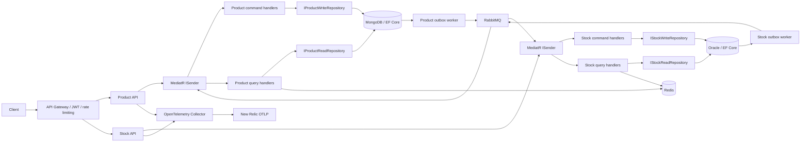
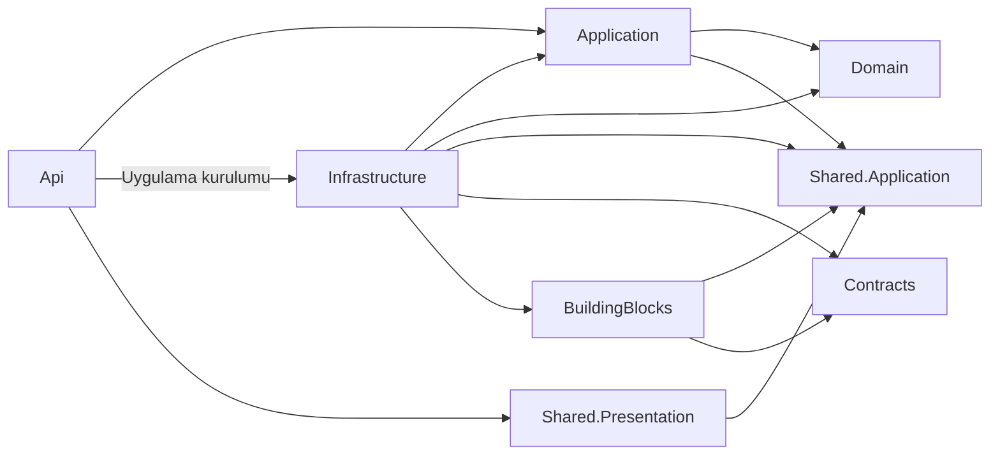

# Product / Stock mikroservisleri

.NET 10, EF Core 10, MongoDB, Oracle, RabbitMQ, Redis ve OpenTelemetry kullanan iki bağımsız HTTP servisi. İki servis de Clean Architecture ve MediatR tabanlı CQRS ile düzenlenmiştir: controller HTTP işlemlerini, application command/query handler'ları kullanım senaryolarını, domain entity iş kurallarını, infrastructure ise veri erişimi ve dış sistem entegrasyonlarını yönetir. Controller ve mesaj tüketicileri `ISender.Send(...)` ile ilgili handler'a yönlendirilir.



## Katmanlar ve bağımlılıklar

| Katman | Sorumluluk | Bağımlılık |
|---|---|---|
| Domain | `Entities/ProductItem`, `Entities/StockItem`; ürün ve stok iş kuralları | Dış katman veya framework bağımlılığı yok |
| Application | `Commands`, `Queries`, `Abstractions`, `DTOs`, `Events`, `Caching`; kullanım senaryoları ve interface'ler | Kendi Domain projesi, Shared.Application, MediatR |
| Infrastructure | `Repositories`, `Configurations`, `Messaging`, DbContext ve DI kayıtları | Kendi Application/Domain projeleri, ortak soyutlamalar, Contracts ve BuildingBlocks |
| Api | `Controllers`, `Models`, HTTP yönlendirme ve uygulamayı kuran `Program.cs` | Application, Shared.Presentation; uygulamanın kurulumu için Infrastructure |
| Shared.Application | Cache, outbox ve Unit of Work interface'leri; uygulama hataları | Başka proje veya harici paket bağımlılığı yok |
| Contracts | Servisler arası mesaj DTO'ları ve topic adları | Başka proje veya harici paket bağımlılığı yok |
| BuildingBlocks | Ortak altyapı: EF Unit of Work, outbox modeli, Redis, RabbitMQ, health ve telemetry | Shared.Application, Contracts ve altyapı paketleri |
| Shared.Presentation | Ortak HTTP hata yönetimi | Shared.Application, ASP.NET Core |

Kaynak kod bağımlılıkları içeriye yönelir:



Her servisin klasör yapısı aynıdır:

```text
Product.Domain/Entities/ProductItem.cs
Product.Application/
  Abstractions/IProductReadRepository.cs, IProductWriteRepository.cs
  Commands/CreateProduct/CreateProductCommand.cs, CreateProductCommandHandler.cs
  Commands/UpdateProduct/UpdateProductCommand.cs, UpdateProductCommandHandler.cs
  Commands/RemoveProduct/RemoveProductCommand.cs, RemoveProductCommandHandler.cs
  Commands/ApplyStockProjection/ApplyStockProjectionCommand.cs, ApplyStockProjectionCommandHandler.cs
  Queries/GetProductById/GetProductByIdQuery.cs, GetProductByIdQueryHandler.cs
  Caching/ProductCacheKeys.cs
  DTOs/ProductDto.cs
  Events/ProductCreatedEvent.cs
Product.Infrastructure/
  Repositories/ProductReadRepository.cs, ProductWriteRepository.cs
  Configurations/ProductConfiguration.cs, OutboxConfiguration.cs
  Messaging/StockChangedHandler.cs, ProductOutboxMessageFactory.cs
  ProductDbContext.cs
  DependencyInjection.cs
Product.Api/
  Controllers/ProductsController.cs, HealthController.cs
  Models/CreateProductRequest.cs, UpdateProductRequest.cs
  Program.cs
```

Stock tarafında aynı yapı `StockItem`, `IStockReadRepository`, `IStockWriteRepository`, `StocksController` ve `ProductCreatedHandler` ile uygulanır. Domain harici paketlerden bağımsızdır. Application yalnızca MediatR'ın request ve handler sözleşmelerini kullanır; DI kayıtları, `DbContext`, EF sorguları, RabbitMQ topic'i veya mesaj serileştirmesi içermez. HTTP istek modelleri Api'de command/query modellerine dönüştürülür. Controller'lar `ISender.Send(...)` üzerinden çalışır; entity'ler yerine DTO döndürür.

`Shared.Application/Abstractions`, `ICache`, `IOutbox`, `IUnitOfWork` ve `IApplicationEvent` interface'lerini içerir. Repository interface'leri kendi Application projelerindedir. Command handler'ları bağımsız uygulama olayları üretir; Infrastructure'daki outbox factory bu olayları `Contracts` mesajlarına dönüştürür ve topic seçer. Mesaj tüketicileri de Infrastructure'da mesajı çözüp bir command oluşturur ve `ISender.Send(...)` ile ilgili handler'a gönderir. Domain ve Application, servisler arası taşıma formatını bilmez.

`IUnitOfWork` ve `IOutbox` aynı scoped `EfUnitOfWork<TContext>` nesnesine bağlanır; repository de aynı DbContext'i kullanır. Entity değişiklikleri ve outbox kayıtları tek `SaveChangesAsync` ile atomik kaydedilir. `OutboxMessage` bir altyapı kalıcılık modelidir ve `BuildingBlocks/Persistence` altındadır. Ortak altyapı kayıtları `BuildingBlocks/DependencyInjection.cs`, servise özel kayıtlar Infrastructure'daki `DependencyInjection.cs` içinde yapılır.

`Directory.Build.targets` derleme sırasında katman bağımlılıklarını denetler: Domain başka projeye veya harici framework'e bağlanamaz; servis Application projeleri yalnızca kendi Domain projesini, Shared.Application'ı ve MediatR paketini kullanabilir; Shared.Application ve Contracts harici paketlerden bağımsızdır. Application'a veritabanı veya HTTP paketi, ASP.NET framework referansı veya dış katman proje referansı eklenmesi derlemeyi durdurur. DI kayıtları Infrastructure'da tutulur.

EF concurrency hataları dış katmanda `ConcurrentUpdateException` olarak çevrilir. Shared.Presentation hata işleyicisi geçersiz giriş için 400, sürüm çakışması için 409 Problem Details döndürür. `[ApiController]` geçersiz JSON ve eksik zorunlu model alanlarını 400 ile yanıtlar. Health controller'ları framework'ün `HealthCheckService` soyutlamasını kullanır; gerçek bağımlılık kontrolleri altyapıda yapılır. `Program.cs` servis kayıtları, middleware ve controller eşlemesinden oluşur; HTTP iş mantığı içermez. Oracle tablo/kolonları ve MongoDB koleksiyon adları korunmuştur.

## CQRS akışı

Her kullanım senaryosunun kendi değişmez command/query kaydı ve handler sınıfı vardır. Yanıt döndüren command ve query'ler `IRequest<TResult>`, yalnızca işlem yapan command'lar `IRequest` uygular. Handler'lar `IRequestHandler<TRequest, TResult>` veya `IRequestHandler<TRequest>` uygular ve `Handle(...)` metodunda işlemi yürütür. Infrastructure'daki `AddMediatR(...)`, ilgili Application assembly'sini tarayarak handler'ları kaydeder. MediatR'ın transient handler'ları, HTTP isteği veya mesaj tüketimi sırasında açılan scope içindeki repository ve Unit of Work nesnelerini kullanır.

MediatR sürümü `Directory.Build.props` içinde `12.5.0` olarak sabitlenmiştir. Bu sürüm [Apache-2.0 lisanslıdır](https://www.nuget.org/packages/MediatR/12.5.0) ve lisans anahtarı gerektirmez.

| Servis | Kullanım senaryosu | Command / Query | Handler |
|---|---|---|---|
| Product | Ürün oluşturma | `CreateProductCommand` | `CreateProductCommandHandler` |
| Product | Ürün güncelleme | `UpdateProductCommand` | `UpdateProductCommandHandler` |
| Product | Ürün silme | `RemoveProductCommand` | `RemoveProductCommandHandler` |
| Product | Stok projeksiyonunu uygulama | `ApplyStockProjectionCommand` | `ApplyStockProjectionCommandHandler` |
| Product | Ürün okuma | `GetProductByIdQuery` | `GetProductByIdQueryHandler` |
| Stock | Stok başlatma | `InitializeStockCommand` | `InitializeStockCommandHandler` |
| Stock | Stok hareketi | `AdjustStockCommand` | `AdjustStockCommandHandler` |
| Stock | Stok okuma | `GetStockByProductIdQuery` | `GetStockByProductIdQueryHandler` |

Okuma akışı `Controller → ISender.Send(query) → QueryHandler → IReadRepository → DTO` şeklindedir. Query handler'ları yalnızca okuma repository interface'ine ve cache'e bağımlıdır; Unit of Work, outbox veya entity değiştirme metodu kullanmaz. Read repository uygulamaları Infrastructure'da `AsNoTracking` ile okur ve DTO döndürür.

Yazma akışı `Controller veya mesaj tüketicisi → ISender.Send(command) → CommandHandler → IWriteRepository → Entity → Unit of Work` şeklindedir. Command handler'ları domain iş kurallarını çalıştırır, gerektiğinde outbox olayı ekler, tek kayıt işlemiyle değişiklikleri kaydeder ve ilgili cache anahtarını geçersizleştirir. Yazma repository'leri güncelleme için tracked entity döndürür. Stok sürüm kontrolü ve eski/tekrar mesajların idempotent işlenmesi command handler'larında korunur.

Controller ve RabbitMQ tüketicileri yalnızca `ISender` kullanır; somut handler veya yönlendirme yapan service sınıflarına bağımlı değildir. HTTP yolları, yanıt modelleri ve cancellation token aktarımı korunur.

Okuma ve yazma modelleri/interface'leri ayrıdır; her mikroservis mevcut tek veritabanını kullanır. CQRS ayrımı uygulama kodundadır. Product'ın stok görünümü, Stock'tan gelen olaylarla güncellenen ve eventual consistency kullanan bir okuma projeksiyonudur.

## Docker ile çalıştırma

Gateway, JWT, rate limiting ve trace alanları için [kullanım rehberi](docs/gateway-security.md). İş endpoint'leri token gerektirir.

Gereksinimler: Linux x64/uyumlu Docker ortamı, Docker Compose v2, yaklaşık 12 GB boş alan ve en az 4 GB RAM. Oracle ilk açılışı birkaç dakika sürebilir. Docker `vfs` sürücüsü katmanları kopyaladığından daha fazla disk gerektirir; `overlay2` önerilir.

```bash
./scripts/init-env.sh
# .env içindeki rastgele geliştirme parolaları korunur; Git'e eklenmez.
docker compose up -d --build
```

Gateway portu 5000, Product portu 5001, Stock portu 5002. RabbitMQ yönetimi 15672; geliştirme kullanıcısı `mikroservis`, parola `.env` içindedir. Bütün host portları yalnızca loopback'e bağlanır. MongoDB tek düğümlü replica set olarak başlatılır: ürün ve outbox kaydının aynı transaction içinde yazılabilmesi için gereklidir. Oracle uygulama kullanıcısı `stock`, PDB `FREEPDB1`.

Compose API'leri `Development` ortamında çalıştırır. Swagger UI yalnızca bu ortamda açıktır: Product için `http://localhost:5001/swagger/index.html`, Stock için `http://localhost:5002/swagger/index.html`. OpenAPI belgeleri her API'de `/swagger/v1/swagger.json` adresindedir. RabbitMQ yönetim paneli `http://localhost:15672` adresindedir. API'leri Docker dışında çalıştırırken Swagger için `ASPNETCORE_ENVIRONMENT=Development` ayarlayın.

```bash
docker compose logs --tail 100 product-api stock-api otel-collector
docker compose down                  # veriler named volume'larda korunur
```

## Yerel .NET geliştirme

.NET SDK sürümü `global.json` ile sabitlenmiştir. Paket sürümleri ve bütün projelerin `packages.lock.json` dosyaları depodadır.

```bash
./scripts/init-env.sh
docker compose up -d --wait mongo oracle redis rabbitmq otel-collector
docker compose run --rm mongo-init
dotnet restore Mikroservis.slnx --locked-mode
dotnet build Mikroservis.slnx -c Release --no-restore
python3 scripts/start-local.py
python3 scripts/stop-local.py
```

`start-local.py` kendi kayıtlı API süreçlerini korur; Product/Stock `/health/ready` ve Gateway `/health/live` yanıtlarını bekler. PID ve log dosyaları ignored `.local` dizinindedir. `stop-local.py` yalnızca kendi kayıtlı API süreçlerini durdurur; Windows ve Linux desteklenir. Bulut ortamında SDK `/workspace/tools/dotnet` altındaysa script bunu da kullanabilir. API'ler `dotnet run` ile başlatılacaksa bağlantı ayarlarının yanında `Jwt__SigningKey` ve Development ortamı sağlanmalıdır. Rider için `scripts/prepare-debug.ps1` bütün env dosyalarını üretir.

## API ve mesaj akışı

| Servis | İşlem | HTTP |
|---|---|---|
| Product | Ürün oluştur | `POST /products` |
| Product | Ürün adı ve fiyatını güncelle | `PUT /products/{id}` |
| Product | Ürün sil | `DELETE /products/{id}` |
| Product | Ürün ve stok projeksiyonunu getir | `GET /products/{id}` |
| Stock | Stok miktarı ve sürümünü getir | `GET /stocks/{productId}` |
| Stock | Pozitif/negatif stok hareketi | `POST /stocks/{productId}/adjustments` |
| İkisi | Canlılık / bağımlılık hazırlığı | `GET /health/live`, `GET /health/ready` |

`PUT /products/{id}` isteği `{"name":"Yeni ad","price":1500.00}` gövdesiyle ürünün adını ve fiyatını günceller; stok miktarı ve sürümü korunur. Başarıda güncel DTO ile 200, ürün bulunamazsa 404, geçersiz gövdede 400 döner. `DELETE /products/{id}` Product kaydını siler; başarıda 204, bulunamazsa 404 döner. Her iki işlem de kayıt sonrasında ürün cache'ini geçersizleştirir. Silme Stock servisindeki bağımsız stok kaydını silmez; silinen ürüne ait sonradan gelen stok olayları Product'ta cache'i temizleyip tamamlanır.

```bash
# TOKEN: Gateway /auth/token üzerinden alınan accessToken (15 dakika geçerli).
curl -sS -H "Authorization: Bearer $TOKEN" -H 'Content-Type: application/json' \
  -d '{"name":"Klavye","price":1250.50}' http://localhost:5000/products
# Dönen id ile; RabbitMQ tüketimi asenkron olduğundan ilk stok isteği kısa süre 404 dönebilir.
curl -sS -H "Authorization: Bearer $TOKEN" http://localhost:5000/stocks/PRODUCT_ID
curl -sS -H "Authorization: Bearer $TOKEN" -H 'Content-Type: application/json' \
  -d '{"delta":10,"expectedVersion":1}' \
  http://localhost:5000/stocks/PRODUCT_ID/adjustments
curl -sS -H "Authorization: Bearer $TOKEN" http://localhost:5000/products/PRODUCT_ID
```

1. Product, ürünü ve `product.created` outbox kaydını MongoDB'ye atomik yazar.
2. Publisher confirm kullanan worker olayı durable topic exchange `microservices` üzerinden yayınlar. Başarısız yayın pending kalır ve yeniden denenir.
3. Stock, ürüne ait sıfır stok kaydını ve ilk `stock.changed` olayını Oracle'a aynı transaction ile yazar. Aynı ürün oluşturma olayı yeniden gelirse stok sıfırlanmaz.
4. Stok hareketi `expectedVersion` ve EF optimistic concurrency ile korunur; çakışma 409, negatif miktar/geçersiz giriş 400 döndürür. Stok değişimi ve outbox aynı transaction'dadır.
5. Product, stok olayının `Version` alanını karşılaştırır; eski veya tekrar gelen olayı uygulamaz. Stok projeksiyonu eventual consistency ile güncellenir.

Cache anahtarları servis bazında ayrılır. Query handler'ları Redis cache-aside kullanır (30 saniye TTL); değişiklikler ilgili kaydı geçersizleştirir. Redis kesintisi readiness'i başarısız kılar. Eşzamanlı cache doldurma/geçersizleştirme yarışında görünüm en fazla TTL süresince eski kalabilir.

Teslimat **at least once**'dır; exactly once iddiası yoktur. Tüketici başarısız mesajı bir kez yeniden teslim eder; ikinci başarısızlık mesajı `deadletters` exchange ve `<queue>.dead` kuyruğuna taşır. DLQ izlenmeli ve sorun çözüldükten sonra mesaj tekrar yayınlanmalıdır. Ürün oluşturma endpoint'ine gönderilen her başarılı istek yeni bir ürün oluşturur. Birden fazla worker instance aynı outbox mesajını yayınlayabilir; tüketiciler tekrarları tolere eder. Gelişmiş retry/DLQ yönetimi ve entegrasyon testleri bu değişikliğin kapsamında değildir.

## OpenTelemetry / New Relic

HTTP istekleri, HTTP client çağrıları, RabbitMQ publish/consume activity'leri, ASP.NET Core metrikleri ve yapılandırılmış loglar OTLP ile collector'a gönderilir. İstek trace context'i outbox'a kaydedilir ve RabbitMQ `traceparent` header'ıyla taşınır. Varsayılan collector telemetry'yi hem `debug` exporter'a hem yerel Aspire Dashboard'a verir; hesap anahtarı olmadan yerel doğrulama yapılabilir.

### Yerel Redis ve OpenTelemetry panelleri

```powershell
docker compose up -d redisinsight aspire-dashboard otel-collector
```

- RedisInsight: `http://localhost:5540`. `Mikroservis Redis` bağlantısı otomatik tanımlanır (`redis:6379`). Browser bölümünde `product:*` ve `stock:*` anahtarlarını görebilirsiniz. Cache GET istekleriyle doldurulur ve 30 saniye sonra silinir. .NET distributed cache verileri hash olarak saklanır; JSON içerik `data` alanındadır.
- OpenTelemetry / Aspire Dashboard: `http://localhost:18888`. Traces, Metrics ve Structured logs ekranlarında `product-service` ve `stock-service` verileri görünür. API'ler çalışmalı ve istek almalıdır; geçmiş Collector logları panele aktarılmaz. Metrikler ilk gönderim aralığından sonra görünür. Panel verileri bellekte tutulur ve panel yeniden başlatılınca sıfırlanır.

Akış: `API → OpenTelemetry Collector (:4317) → Aspire Dashboard`. Collector'ın 4317/4318 portları veri kabul eder; web paneli 18888 portundadır. Paneller yalnızca localhost üzerinden erişilebilir; Aspire geliştirme paneli anonim erişim kullanır. RedisInsight bağlantı ayarları `redisinsight-data` volume'unda saklanır. New Relic yapılandırması da aynı anda yerel Aspire paneline veri gönderir.

New Relic'e göndermek için ingest license key'i güvenli environment ayarlarına veya ignored `.env` dosyasına `NEW_RELIC_LICENSE_KEY` adıyla ekleyin. Anahtarı Git'e eklemeyin. Sonra:

```bash
docker compose -f compose.yaml -f compose.newrelic.yaml up -d otel-collector
```

ABD endpoint varsayılanı `https://otlp.nr-data.net:4318`; AB hesabında `NEW_RELIC_OTLP_ENDPOINT=https://otlp.eu01.nr-data.net:4318` ayarlayın. Collector TLS doğrulamasını korur ve geçici gönderim hatalarını yeniden dener. Proxy kullanılan ortamlarda collector'a `HTTPS_PROXY`/`HTTP_PROXY` aktarılır. Collector loglarında 401/403 varsa ingest key ve hesap bölgesini kontrol edin. New Relic'te `service.name` değerleri `product-service` ve `stock-service` olarak görünür. Ayrı New Relic .NET ajanı gerekli değildir; entegrasyon OpenTelemetry üzerinden yapılır.

## Oracle migration ve dağıtım

Stock başlangıç migration'ı `Stock.Infrastructure/Migrations` içindedir. Compose ve yerel script geliştirme için `Database__Initialize=true` kullanır: Stock `MigrateAsync`, Product `EnsureCreatedAsync` çalıştırır. Üretimde bu flag'i kapatın ve Oracle migration SQL'ini ayrı, kontrollü deployment adımında uygulayın. MongoDB sağlayıcısı SQL migration kullanmaz.

```bash
dotnet tool install dotnet-ef --tool-path .local/tools --version 10.0.11
.local/tools/dotnet-ef migrations script --idempotent \
  --project src/Stock/Stock.Infrastructure \
  --startup-project src/Stock/Stock.Infrastructure --output .local/stock-schema.sql
```

Bu proje çalışır geliştirme temelidir. Üretim için kimlik doğrulama/yetkilendirme, TLS bağlantıları, Redis/Mongo erişim kontrolü, secret yönetimi, outbox arşivleme/temizleme, DLQ alarmı ve HA topolojisi eklenmelidir. Otomatik başlangıç migration'ını birden fazla replica'da kullanmayın.
