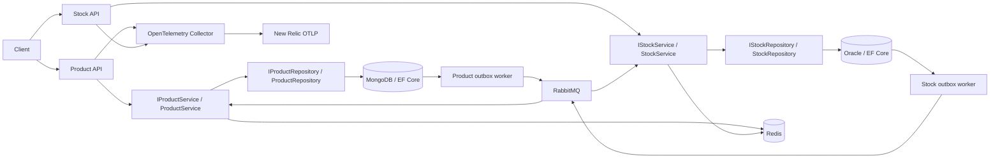
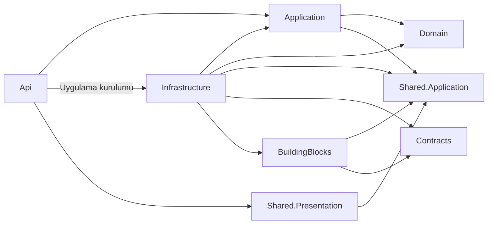

# Product / Stock mikroservisleri

.NET 10, EF Core 10, MongoDB, Oracle, RabbitMQ, Redis ve OpenTelemetry kullanan iki bağımsız HTTP servisi. İki servis de Clean Architecture ile düzenlenmiştir: controller HTTP işlemlerini, application service kullanım senaryolarını, domain entity iş kurallarını, infrastructure ise veri erişimi ve dış sistem entegrasyonlarını yönetir.



## Katmanlar ve bağımlılıklar

| Katman | Sorumluluk | Bağımlılık |
|---|---|---|
| Domain | `Entities/ProductItem`, `Entities/StockItem`; ürün ve stok iş kuralları | Dış katman veya framework bağımlılığı yok |
| Application | `Abstractions`, `DTOs`, `Events`, `Services`; kullanım senaryoları ve interface'ler | Kendi Domain projesi, Shared.Application |
| Infrastructure | `Repositories`, `Configurations`, `Messaging`, DbContext ve DI kayıtları | Kendi Application/Domain projeleri, ortak soyutlamalar, Contracts ve BuildingBlocks |
| Api | `Controllers`, `Models`, HTTP yönlendirme ve uygulamayı kuran `Program.cs` | Application, Shared.Presentation; uygulamanın kurulumu için Infrastructure |
| Shared.Application | Cache, outbox ve Unit of Work interface'leri; uygulama hataları | Başka proje veya harici paket bağımlılığı yok |
| Contracts | Servisler arası mesaj DTO'ları ve topic adları | Başka proje veya harici paket bağımlılığı yok |
| BuildingBlocks | Ortak altyapı: EF Unit of Work, outbox modeli, Redis, RabbitMQ, health ve telemetry | Shared.Application, Contracts ve altyapı paketleri |
| Shared.Presentation | Ortak HTTP hata yönetimi | Shared.Application, ASP.NET Core |

Kaynak kod bağımlılıkları içeriye yönelir:



Her servisin klasör yapısı aynıdır:

```text
Product.Domain/Entities/ProductItem.cs
Product.Application/
  Abstractions/IProductService.cs, IProductRepository.cs
  DTOs/CreateProductInput.cs, ProductDto.cs
  Events/ProductCreatedEvent.cs
  Services/ProductService.cs
Product.Infrastructure/
  Repositories/ProductRepository.cs
  Configurations/ProductConfiguration.cs, OutboxConfiguration.cs
  Messaging/StockChangedHandler.cs, ProductOutboxMessageFactory.cs
  ProductDbContext.cs
  DependencyInjection.cs
Product.Api/
  Controllers/ProductsController.cs, HealthController.cs
  Models/CreateProductRequest.cs
  Program.cs
```

Stock tarafında aynı yapı `StockItem`, `IStockService`, `IStockRepository`, `StockService`, `StocksController` ve `ProductCreatedHandler` ile uygulanır. Domain ve Application katmanlarında harici paket, DI framework'ü, `DbContext`, EF sorguları, RabbitMQ topic'i veya mesaj serileştirmesi bulunmaz. HTTP istek modelleri Api'de uygulama giriş modellerine dönüştürülür. Controller'lar service interface'leri üzerinden çalışır; entity'ler yerine DTO döndürür.

`Shared.Application/Abstractions`, `ICache`, `IOutbox`, `IUnitOfWork` ve `IApplicationEvent` interface'lerini içerir. Repository ve service interface'leri kendi Application projelerindedir. Uygulama servisleri bağımsız uygulama olayları üretir; Infrastructure'daki outbox factory bu olayları `Contracts` mesajlarına dönüştürür ve topic seçer. Mesaj tüketicileri de Infrastructure'da mesajı çözüp ilgili service'i çağırır. Domain ve Application, servisler arası taşıma formatını bilmez.

`IUnitOfWork` ve `IOutbox` aynı scoped `EfUnitOfWork<TContext>` nesnesine bağlanır; repository de aynı DbContext'i kullanır. Entity değişiklikleri ve outbox kayıtları tek `SaveChangesAsync` ile atomik kaydedilir. `OutboxMessage` bir altyapı kalıcılık modelidir ve `BuildingBlocks/Persistence` altındadır. Ortak altyapı kayıtları `BuildingBlocks/DependencyInjection.cs`, servise özel kayıtlar Infrastructure'daki `DependencyInjection.cs` içinde yapılır.

`Directory.Build.targets` derleme sırasında katman bağımlılıklarını denetler: Domain başka projeye veya harici framework'e bağlanamaz; Application yalnızca kendi Domain projesini ve Shared.Application'ı kullanabilir; Contracts yalnızca bağımsız mesaj sözleşmelerini içerir. Böylece iç katmana sonradan veritabanı, HTTP veya DI bağımlılığı eklenmesi derlemeyi durdurur.

EF concurrency hataları dış katmanda `ConcurrentUpdateException` olarak çevrilir. Shared.Presentation hata işleyicisi geçersiz giriş için 400, sürüm çakışması için 409 Problem Details döndürür. `[ApiController]` geçersiz JSON ve eksik zorunlu model alanlarını 400 ile yanıtlar. Health controller'ları framework'ün `HealthCheckService` soyutlamasını kullanır; gerçek bağımlılık kontrolleri altyapıda yapılır. `Program.cs` servis kayıtları, middleware ve controller eşlemesinden oluşur; HTTP iş mantığı içermez. Oracle tablo/kolonları ve MongoDB koleksiyon adları korunmuştur.

## Docker ile çalıştırma

Gereksinimler: Linux x64/uyumlu Docker ortamı, Docker Compose v2, yaklaşık 12 GB boş alan ve en az 4 GB RAM. Oracle ilk açılışı birkaç dakika sürebilir. Docker `vfs` sürücüsü katmanları kopyaladığından daha fazla disk gerektirir; `overlay2` önerilir.

```bash
./scripts/init-env.sh
# .env içindeki rastgele geliştirme parolaları korunur; Git'e eklenmez.
docker compose up -d --build
```

Product portu 5001, Stock portu 5002. RabbitMQ yönetimi 15672; geliştirme kullanıcısı `mikroservis`, parola `.env` içindedir. Bütün host portları yalnızca loopback'e bağlanır. MongoDB tek düğümlü replica set olarak başlatılır: ürün ve outbox kaydının aynı transaction içinde yazılabilmesi için gereklidir. Oracle uygulama kullanıcısı `stock`, PDB `FREEPDB1`.

```bash
docker compose logs --tail 100 product-api stock-api otel-collector
docker compose down                  # veriler named volume'larda korunur
```

## Yerel .NET geliştirme

.NET SDK sürümü `global.json` ile sabitlenmiştir. Paket sürümleri ve bütün projelerin `packages.lock.json` dosyaları depodadır.

```bash
./scripts/init-env.sh
docker compose up -d --wait mongo oracle redis rabbitmq otel-collector
docker compose run --rm mongo-init
dotnet restore Mikroservis.slnx --locked-mode
dotnet build Mikroservis.slnx -c Release --no-restore
python3 scripts/start-local.py
python3 scripts/stop-local.py
```

`start-local.py` mevcut API süreçlerini korur ve iki `/health/ready` yanıtını bekler. PID ve log dosyaları ignored `.local` dizinindedir. `stop-local.py` yalnızca kendi kayıtlı API süreçlerini durdurur. Bulut ortamında SDK `/workspace/tools/dotnet` altındaysa script bunu da kullanabilir. API'ler `dotnet run` ile başlatılacaksa `ConnectionStrings__Database`, `ConnectionStrings__Redis`, `RabbitMQ__Uri` ve `ASPNETCORE_URLS` sağlanmalıdır.

## API ve mesaj akışı

| Servis | İşlem | HTTP |
|---|---|---|
| Product | Ürün oluştur | `POST /products` |
| Product | Ürün ve stok projeksiyonunu getir | `GET /products/{id}` |
| Stock | Stok miktarı ve sürümünü getir | `GET /stocks/{productId}` |
| Stock | Pozitif/negatif stok hareketi | `POST /stocks/{productId}/adjustments` |
| İkisi | Canlılık / bağımlılık hazırlığı | `GET /health/live`, `GET /health/ready` |

```bash
curl -sS -H 'Content-Type: application/json' \
  -d '{"name":"Klavye","price":1250.50}' http://localhost:5001/products
# Dönen id ile; RabbitMQ tüketimi asenkron olduğundan ilk stok isteği kısa süre 404 dönebilir.
curl -sS http://localhost:5002/stocks/PRODUCT_ID
curl -sS -H 'Content-Type: application/json' \
  -d '{"delta":10,"expectedVersion":1}' \
  http://localhost:5002/stocks/PRODUCT_ID/adjustments
curl -sS http://localhost:5001/products/PRODUCT_ID
```

1. Product, ürünü ve `product.created` outbox kaydını MongoDB'ye atomik yazar.
2. Publisher confirm kullanan worker olayı durable topic exchange `microservices` üzerinden yayınlar. Başarısız yayın pending kalır ve yeniden denenir.
3. Stock, ürüne ait sıfır stok kaydını ve ilk `stock.changed` olayını Oracle'a aynı transaction ile yazar. Aynı ürün oluşturma olayı yeniden gelirse stok sıfırlanmaz.
4. Stok hareketi `expectedVersion` ve EF optimistic concurrency ile korunur; çakışma 409, negatif miktar/geçersiz giriş 400 döndürür. Stok değişimi ve outbox aynı transaction'dadır.
5. Product, stok olayının `Version` alanını karşılaştırır; eski veya tekrar gelen olayı uygulamaz. Stok projeksiyonu eventual consistency ile güncellenir.

Cache anahtarları servis bazında ayrılır. Service okuma işlemleri Redis cache-aside kullanır (30 saniye TTL); değişiklikler ilgili kaydı geçersizleştirir. Redis kesintisi readiness'i başarısız kılar. Eşzamanlı cache doldurma/geçersizleştirme yarışında görünüm en fazla TTL süresince eski kalabilir.

Teslimat **at least once**'dır; exactly once iddiası yoktur. Tüketici başarısız mesajı bir kez yeniden teslim eder; ikinci başarısızlık mesajı `deadletters` exchange ve `<queue>.dead` kuyruğuna taşır. DLQ izlenmeli ve sorun çözüldükten sonra mesaj tekrar yayınlanmalıdır. Product endpoint'inin HTTP tekrarları için idempotency key desteği henüz yoktur. Birden fazla worker instance aynı outbox mesajını yayınlayabilir; tüketiciler tekrarları tolere eder.

## OpenTelemetry / New Relic

HTTP istekleri, HTTP client çağrıları, RabbitMQ publish/consume activity'leri, ASP.NET Core metrikleri ve yapılandırılmış loglar OTLP ile collector'a gönderilir. İstek trace context'i outbox'a kaydedilir ve RabbitMQ `traceparent` header'ıyla taşınır. Varsayılan collector telemetry'yi `debug` exporter'a verir; hesap anahtarı olmadan yerel doğrulama yapılabilir.

New Relic'e göndermek için ingest license key'i güvenli environment ayarlarına veya ignored `.env` dosyasına `NEW_RELIC_LICENSE_KEY` adıyla ekleyin. Anahtarı Git'e eklemeyin. Sonra:

```bash
docker compose -f compose.yaml -f compose.newrelic.yaml up -d otel-collector
```

ABD endpoint varsayılanı `https://otlp.nr-data.net:4318`; AB hesabında `NEW_RELIC_OTLP_ENDPOINT=https://otlp.eu01.nr-data.net:4318` ayarlayın. Collector TLS doğrulamasını korur ve geçici gönderim hatalarını yeniden dener. Proxy kullanılan ortamlarda collector'a `HTTPS_PROXY`/`HTTP_PROXY` aktarılır. Collector loglarında 401/403 varsa ingest key ve hesap bölgesini kontrol edin. New Relic'te `service.name` değerleri `product-service` ve `stock-service` olarak görünür. Ayrı New Relic .NET ajanı gerekli değildir; entegrasyon OpenTelemetry üzerinden yapılır.

## Oracle migration ve dağıtım

Stock başlangıç migration'ı `Stock.Infrastructure/Migrations` içindedir. Compose ve yerel script geliştirme için `Database__Initialize=true` kullanır: Stock `MigrateAsync`, Product `EnsureCreatedAsync` çalıştırır. Üretimde bu flag'i kapatın ve Oracle migration SQL'ini ayrı, kontrollü deployment adımında uygulayın. MongoDB sağlayıcısı SQL migration kullanmaz.

```bash
dotnet tool install dotnet-ef --tool-path .local/tools --version 10.0.11
.local/tools/dotnet-ef migrations script --idempotent \
  --project src/Stock/Stock.Infrastructure \
  --startup-project src/Stock/Stock.Infrastructure --output .local/stock-schema.sql
```

Bu proje çalışır geliştirme temelidir. Üretim için kimlik doğrulama/yetkilendirme, TLS bağlantıları, Redis/Mongo erişim kontrolü, secret yönetimi, outbox arşivleme/temizleme, DLQ alarmı ve HA topolojisi eklenmelidir. Otomatik başlangıç migration'ını birden fazla replica'da kullanmayın.
